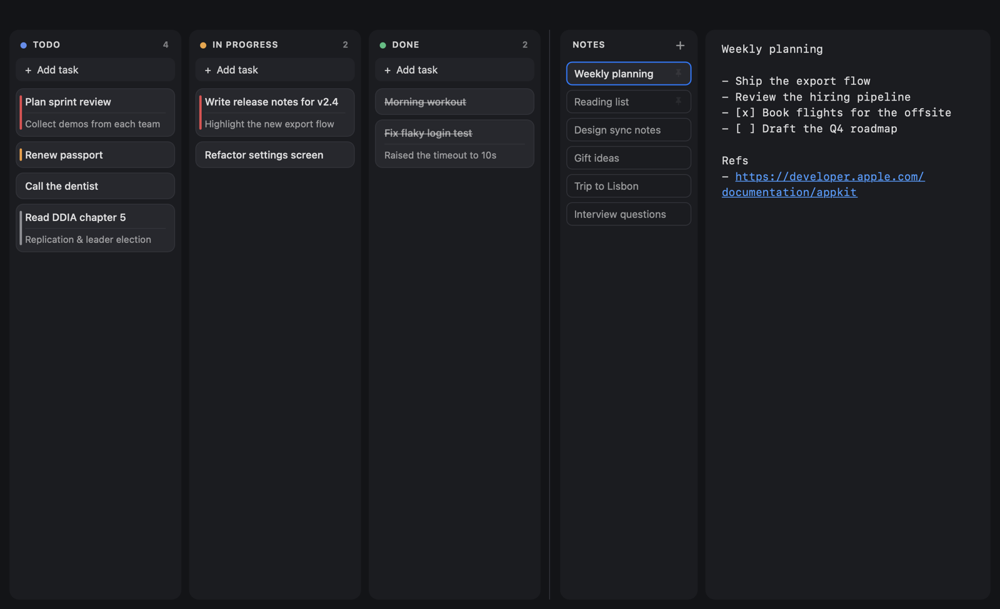

| ⌥⌘F | Search notes & tasks |
# ClayMore

A lightning-fast notes + kanban app for macOS.
Open it, start typing — the cursor is already in your note.



- **Native** Swift + AppKit. No Electron, no web views, no dependencies.
- **Small**: the whole app is ~600 KB.
- **Fast**: first frame in ~185 ms on a cold launch, and reopening is instant (it stays running when you close the window).
- **Local**: everything is stored as plain files on your Mac. No account, no network access.

## Install

Requires macOS 13 (Ventura) or later. Works on Apple Silicon and Intel Macs.

### Option 1 — Download

1. Download `ClayMore.zip` from the [latest release](https://github.com/canberkyigit/ClayMore/releases/latest).
2. Unzip it and drag **ClayMore.app** into your **Applications** folder.
3. Open it. Because ClayMore isn't notarized by Apple, macOS blocks the first launch:
   - Open **System Settings → Privacy & Security**, scroll down, and click **Open Anyway** next to the ClayMore message. You only need to do this once.
   - Or, from Terminal: `xattr -dr com.apple.quarantine /Applications/ClayMore.app`

### Option 2 — Build from source

Building on your own Mac skips the Gatekeeper prompt entirely.

```bash
xcode-select --install          # Xcode Command Line Tools, if you don't have them
git clone https://github.com/canberkyigit/ClayMore.git
cd ClayMore
./build.sh install              # builds and copies ClayMore.app to /Applications
```

To update later: `git pull && ./build.sh install`.

## Features

**Board**
- Three columns: Todo, In Progress, Done. Drag cards between them.
- Each task has a name, an optional description, and a priority (shown as a colored stripe).
- Archive finished work: right-click the Done column → *Archive All Done Tasks*. Find it again under **Archive → Show Archive**, where you can restore or delete tasks.

**Notes**
- A list of notes next to a plain-text editor. A note's first line is its title.
- Autosaves as you type. Empty notes disappear when you leave them.
- Pin notes to the top of the list (right-click → *Pin to Top*).
- Lists continue on Return: `-item`, `- item`, `* item`, `1. item`, `- [ ] item`. Return on an empty item ends the list.
- Links (`https://…`, `www.…`) become clickable.

**Notes ↔ tasks**
- Drag a note onto a column to turn it into a task (first line → name, the rest → description). The note is kept.
- Select text in a note and press **⌘T** (or right-click → *Create Task*) to add it to Todo.
- Right-click a task → *Save as .txt…*, or a note → *Show in Finder* (notes are already .txt files).

**Everywhere**
- **⌃⌥C** brings ClayMore to the front from any app — or hides it.
- **Search** at the top filters notes (title and text) and cards as you type. It ignores case and accents, so `isik` finds “Işık”. ↩ opens the first matching note, ↓ jumps to the results, esc clears. **⌥⌘F** jumps there.
- **Search** at the top filters notes (title and text) and cards as you type. It ignores case and accents, so `isik` finds “Işık”. ↩ opens the first matching note, ↓ jumps to the results, esc clears. Press **⌥⌘F** to jump there.
- Every time the window opens, the cursor is in your note, ready to type. After you close the window or quit, it opens on a fresh note; the previous one is saved in the list.
- **ClayMore → Launch at Login** starts it hidden when your Mac starts, so even the first open of the day is instant.
- Follows the system light/dark appearance.

## Keyboard shortcuts

| Shortcut | Action |
|---|---|
| ⌃⌥C (global) | Show / hide ClayMore |
| ⌘N | New task |
| ⇧⌘N | New note |
| ⌘J / ⌘B | Jump to notes / board |
| ⌘T | Create a task from the selected note text |
| ⇧⌘A | Show archive |
| ⌘F | Find in note |
| ⌘+ / ⌘− / ⌘0 | Note text size |

In the **"Add task" field**: ↩ adds the task, ⌘↩ adds it and opens it to write a description.

On a **selected card**:

| Key | Action |
|---|---|
| ↩ or double-click | Edit |
| ⌫ | Delete (⌘Z to undo) |
| ⌘← / ⌘→ | Move to the previous / next column |
| ← → ↑ ↓ | Move between columns and cards |

## Your data

Everything lives in `~/Library/Application Support/ClayMore/`:

| File | Contents |
|---|---|
| `board.json` | Tasks |
| `notes.json` | Note list (titles, order, pins) |
| `notes/*.txt` | One plain-text file per note |
| `archive.json` | Archived tasks |

Notes are ordinary `.txt` files, so you can open them with any editor. Time Machine backs this folder up like the rest of your home folder.

## Development

```bash
./build.sh          # build/ClayMore.app for this Mac
./build.sh install  # build and copy to /Applications
./build.sh dist     # universal (Apple Silicon + Intel) build + build/ClayMore.zip
./build.sh debug    # build with the dev hooks in Sources/DebugHooks.swift
```

The app is a handful of files in `Sources/`, built directly with `swiftc` — no Xcode project. Views are laid out by hand and cards are drawn directly rather than built from subviews, which keeps launch and scrolling fast.
